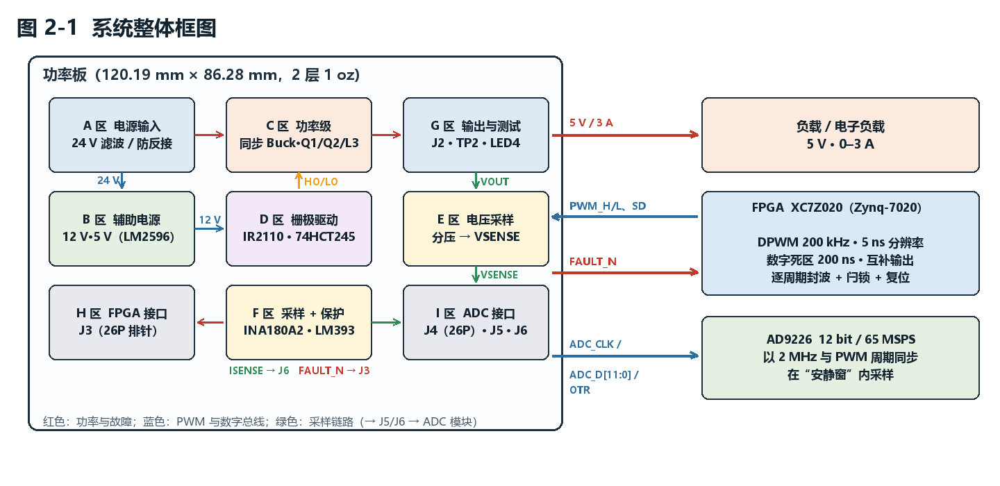

# 基于 FPGA 的全数字控制同步 Buck 降压电源

> **2026 嵌入式芯片与系统设计竞赛 · FPGA 赛道 · 自主选题组**
> 24 V 输入 → 5 V / 0–3 A 输出的同步 Buck 变换器，**控制环路完全由 FPGA 数字实现**：
> 200 kHz 互补 PWM、200 ns 数字死区、58 ns 逐周期保护、12 位 ADC 与 PWM 周期同步采样、2P2Z 数字补偿器。
>
> **应用定位**：作为**精密仪器低压供电轨的数字预稳压级**——面向“对供电稳定性要求高、单路功率数十瓦以内”的
> 负载（如半导体制造与精密测量装备中传感器、模拟前端的 5 V 供电轨），采用“开关前级＋线性后级”两级架构：
> 本作品承担效率、瞬态与保护，后级以 π 型滤波与 LDO 把纹波压到毫伏级，直流精度由电压基准决定。详见报告 §1.2「应用领域」。

> ### 📜 开发过程留痕
>
> 本作品从零开始逐日推进，**完整开发过程共 130 余次提交**（每次问题定位、方案迭代与实测修正均有独立记录），
> 全部保留在 **Gitee 主仓库**：
>
> **项目主页（含完整开发留痕）：[https://gitee.com/shibainu1145/fpga](https://gitee.com/shibainu1145/fpga)**
>
> 逐日提交历史：[https://gitee.com/shibainu1145/fpga/tree/master](https://gitee.com/shibainu1145/fpga/tree/master)
>
> **按日期整理的过程摘要：[开发过程记录.md](开发过程记录.md)**（与提交历史一一对应，含典型问题与解决的完整记录）
>
> 如需逐条核对每一次迭代，请访问上述 Gitee 仓库的提交历史。



---

## 1. 项目简介

本作品以 AMD Zynq-7020（AX7020 开发板）的**可编程逻辑（PL）**为核心，实现一台数字控制同步 Buck 降压变换器。
与"FPGA 只当 PWM 发生器"的常见做法不同，本作品把**调制、保护、采样时序与闭环补偿全部放在 PL 内**，
并通过"采样—比较—调节"构成完整闭环：

- **调制**：200 MHz 时钟域内产生 200 kHz 互补 PWM，时间分辨率 **5 ns**（占空比步进 0.1%），数字死区 **200 ns**（40 × 5 ns）；
- **保护**：硬件比较器（LM393）检测过流/过压 → FPGA 在 **2 个时钟（10 ns）内封锁 PWM**，经数字链路总延时 **58 ns**、含 1 µs 滤波的端到端延时 **≈1.0 µs**，并闩锁至人工复位；
- **采样**：AD9226（12 bit / 65 MSPS）以 **2 MHz 与 PWM 周期同步**，采样点固定在开关瞬态结束后的"安静窗"内；
- **补偿**：片内 2P2Z 数字补偿器（Q14 定点、10 拍流水 MAC），带输出限幅与抗积分饱和；
- **功率级**：24 V → 5 V / 0–3 A 同步 Buck，IR2110 浮动驱动、10 µH 一体成型电感、全陶瓷输出电容。

---

## 2. 主要技术指标

| 项目 | 指标 | 状态 |
|---|---|---|
| 输入电压 | 24 V DC | — |
| 输出 | 5 V / 0–3 A（15 W） | — |
| 开关频率 | 200 kHz（周期 5000 ns） | ✅ 实测 |
| **数字死区** | **200 ns**（40 × 5 ns，高低侧双向） | ✅ 实测（ILA 40 × 5 ns + 示波器双证据） |
| **DPWM 时间分辨率** | **5 ns**（占空比步进 0.1%） | ✅ 实测 |
| PWM 电平 / 架构 | 3.3 V LVCMOS33 / 严格互补 | ✅ 实测 |
| **保护响应时间** | 逻辑封波 **2 拍 = 10 ns**；数字链路总延时 **58 ns**；含 1 µs 滤波的端到端 **≈1.0 µs**（驱动再 +95~120 ns） | ✅ 实测（ILA + 示波器双证据） |
| 保护机制 | 硬件 OCP/OVP 比较器 + 逐周期封锁 + 故障闩锁 | ✅ 6 项证据齐备 |
| 电流采样 | 10 mΩ 分流 + INA180A2（50 V/V）= 0.5 V/A | ✅ |
| 电压采样 | 板外分压比 ≈0.20（5 V → 1.01 V），实测标定 `REF_CODE` = 2453 | ✅ 已标定 |
| ADC | AD9226，12 bit / 65 MSPS，2 MHz 同步采样 | ✅ |
| ADC 实测特性 | 灵敏度 **≈416 码/V**、零点 **2048**（12 位中点）、抖动 ±1 LSB（3 点标定） | ✅ 已标定 |
| 保护阈值 | OCP 3.5 A（1.5–4.5 A 可调）、OVP 设计目标 5.76 V（**实际动作点未实测**，下一版重标定并做 ADC 满量程/OTR 联动校核） | ⚠️ 设计值 |
| 控制算法 | 2P2Z 数字补偿器（Q14 定点、48 位累加） | ✅ 实现并逐点对拍 |
| **闭环仿真** | 稳态 **4.9946 V**、纹波 **14.9 mV**、相位裕度 **83.9°**、穿越频率 **6.99 kHz** | ✅ 端到端 RTL 闭环仿真 |
| **闭环实测（上板）** | 负载端 **5.00 V**、ADC 码 **2453** 与 REF_CODE 一致（误差 0 码）、纹波 **60 mV**、带载 2 Ω 占空比 **22.6~23.0 %** | ✅ 已上板联调 |
| 功率板 | 120.19 × 86.28 mm、2 层、1 oz、4 × M3 安装孔 | ✅ 已制板 |

---

## 3. 系统组成

```
┌──────────────────────┐        ┌──────────────────────┐        ┌────────────────────┐
│  功率板（120 × 86）   │        │  FPGA（Zynq-7020 PL） │        │  AD9226 模块       │
│  A 区 电源输入        │        │  · DPWM 200 kHz       │        │  12 bit / 65 MSPS  │
│  B 区 辅助电源 12/5 V │        │  · 保护与闩锁         │◄───────┤  2 MHz 同步采样    │
│  C 区 同步 Buck 功率级│◄───────┤  · 2P2Z 补偿器        │        └────────────────────┘
│  D 区 栅极驱动        │  PWM   │  · ADC 采样接口       │                 ▲
│  E 区 电压采样        ├───────►│                       │                 │
│  F 区 电流采样 + 保护 │  反馈  └──────────────────────┘                 │
│  G 区 输出与测试      │                                                  │
│  H 区 FPGA 接口       │                                                  │
│  I 区 ADC 模块接口    │──────────────────────────────────────────────────┘
└──────────────────────┘
```

**功率板按功能划分为九个区**：A 电源输入 · B 辅助电源 · C 功率级 · D 栅极驱动 · E 电压采样 ·
F 电流采样与保护 · G 输出与测试 · H FPGA 接口 · I ADC 模块接口。各区的划分与外形见技术文档
§2.2.2（图 2-2），布线与地平面取舍见 §2.2.3。

---

## 4. 设计与工程特点

1. **采样相位与功率级约束对齐** —— 电流采样取自低边管源极的分流电阻，只在低边导通期间有效；
   采样时刻由 RTL 精确安排在 PWM 周期起点后 3000 ns（低边导通窗 1000–4980 ns 内），且避开开关瞬态。
2. **三层保护** —— 硬件比较器快速检测、FPGA 逐周期封波（**2 拍 = 10 ns**，数字链路 **58 ns**，含 1 µs 滤波端到端 **≈1.0 µs**）、故障闩锁 + 人工复位，
   兼顾速度与安全；先用实测验证保护链路、再进入闭环调试。
3. **仿真驱动设计** —— 搭建"被控对象 → ADC → 采样接口 → 补偿器 → DPWM"端到端 RTL 闭环仿真，
   并据其标定结果**纠正了 ADC 定标假设**（原按手册 409.6 码/V 建模，3 点实测标定为 **≈416 码/V**、零点 2048；
   相应重新校核了反馈分压比余量与补偿器定标）。
4. **可验证的工程方法** —— 原理图完成后以导出网表**逐网络逐引脚核对**，并以"单脚网络/悬空元件"
   作为健康指标（终版：51 网络、零单脚网、零悬空元件）；封装与 BOM 三层核查；
   投板前检查 Gerber 的层叠、板框、孔径与孔位；装配前对**全部有极性器件**做极性核对。
5. **面向开关电源的板级设计纪律** —— 开关环路面积最小化、功率地与信号地分域单点星形汇接、
   电流采样开尔文连接、按载流分级的铜宽（3 A 级 ≥2.5–3 mm）与多过孔换层。

---

## 5. 设计验证

| 项 | 方法 | 结果 |
|---|---|---|
| 死区 | 片内逻辑分析仪（5 ns 时间分辨率）+ 外部示波器 | 高低侧双向 **200 ns**（40 × 5 ns）✅ |
| 保护响应 | 片内"边沿启动 + 读数冻结"计数器 + 示波器 | 逻辑封波 **2 拍 = 10 ns**、数字链路 **58 ns**、端到端 **≈1.0 µs** ✅ |
| 保护链路 | 封波完整性 / `SD` 关断 / 逐周期自恢复 / 闩锁不自恢复 / 人工复位 / 响应时间 | **6/6 通过** ✅ |
| ADC 接口 | 独立测试平台 7 项自检 | **7/7 通过** ✅ |
| 补偿器 | 与定点模型逐点对拍（1100 组向量） | **零失配** ✅ |
| 闭环性能 | 端到端 RTL 闭环仿真 + 上板实测 | 仿真：稳态 4.9946 V、纹波 14.9 mV、相位裕度 83.9°；实测：5.00 V、纹波 60 mV、误差 0 码 ✅ |
| 板级 | 静态电阻检查、限流上电、分区验收 | 已通过 ✅ |

> **首板调试记录**：首次上电出现输入电流进入限流、输出电压下滑的现象。经"恒功率负载特征"推断后
> 定位为母线电解电容反接（原理图使用无极性符号、而封装极性丝印固定在 1 脚，符号镜像导致丝印与
> 电气极性相反）。按实测焊盘电压重新装配后板卡恢复正常，并据此建立了**全板极性核对流程**
> （问题与下一版改板结论见技术文档 §3.6）。

---

## 6. 仓库结构

```
.
├── README.md                 ← 本文件（项目总览与导航）
├── 01-项目说明/               ← 作品简介
├── 02-FPGA工程/               ← 完整 RTL（DPWM / ADC 采集 / 2P2Z / 顶层）、回归测试台、
│                                XDC 引脚约束（上板实际使用）、Vivado IP 配置（clk_wiz / ILA）、
│                                信号接线表（接口契约）
├── 03-EDA导出/                ← 立创EDA 导出的网表、BOM、Gerber，以及逐版核对记录
│   └── 工具/                  ← 网表/BOM 解析与校验脚本
└── 04-技术文档/               ← 技术文档（docx + PDF）、全部插图、文档生成与校验脚本
    └── 工具/
```

> **关于编号 05（仅 Gitee 主仓库）**：`05-硬件与采购/` 是功率板的设计过程文档（A–I 九区分区设计说明、元件清单与选料、
> PCB 布局规划与地平面设计、打板检查清单、极性核对、上电与闭环联调清单、下一版改板清单）。
> 它属于内部工程记录、含大量逐日往返与采购信息，**公开交付快照（GitHub）不含该目录**；
> 完整留痕保留在 Gitee 主仓库（见文首链接）。Gitee 主仓库的目录编号为 **01–05**，
> 公开交付快照（GitHub）剔除该目录后为连续的 **01–04**。硬件设计成果以本仓库的 `03-EDA导出/`（BOM、Gerber、
> 网表与逐版核对记录）和 `04-技术文档/图/`（原理图分区图、PCB 版图、实物照片）为准，相关设计取舍
> 与技术文档 §2.2、§3.6 一致。

---

## 7. 复现说明

| 内容 | 方法 |
|---|---|
| RTL 回归仿真 | 进入 `02-FPGA工程/sim/`，运行 `run_sim.bat`（Vivado 自带 xsim），验证 DPWM 五项指标 |
| 技术文档 | `04-技术文档/工具/生成脚本.py`（python-docx + Pillow）重新生成 docx |
| 文档校验 | `04-技术文档/工具/校验.py` 检查页眉、页脚页码、版心与图表宽度 |
| 网表/BOM 校验 | `03-EDA导出/工具/` 下的解析脚本（openpyxl）|
| EDA 工程 | 原始工程在立创EDA 专业版中维护；本仓库提供导出的网表、BOM、Gerber 与逐版核对记录 |

**依赖**：Vivado（7 系列器件）· Python 3（python-docx、openpyxl、Pillow）

---

## 8. 文档与图纸索引

| 内容 | 位置 |
|---|---|
| **技术文档（正式报告）** | [`04-技术文档/技术文档-FPGA数字电源-20261012.docx`](04-技术文档/技术文档-FPGA数字电源-20261012.docx)（可编辑）· **PDF 版**：[`04-技术文档/技术文档-FPGA数字电源-20261012.pdf`](04-技术文档/技术文档-FPGA数字电源-20261012.pdf)（33 页，免 Word 直接预览） |
| 作品简介 | [`01-项目说明/01-作品简介.md`](01-项目说明/01-作品简介.md) |
| **完整 RTL（源码）** | [`02-FPGA工程/rtl/`](02-FPGA工程/rtl/)：DPWM 调制器、ADC 采集接口、2P2Z 补偿器、顶层集成 |
| **Vivado IP 配置** | [`02-FPGA工程/ip/`](02-FPGA工程/ip/)：`clk_wiz_0`（50→200 MHz）、`ila_0`（6 探针）的 `.xci` 与 ILA 重建脚本 |
| **信号接口契约** | [`02-FPGA工程/接口表/1-信号接线表.md`](02-FPGA工程/接口表/1-信号接线表.md) |
| BOM（EDA 导出表） | [`03-EDA导出/BOM_Board1_PCB1_2026-10-11.xlsx`](03-EDA导出/BOM_Board1_PCB1_2026-10-11.xlsx) |
| **网表 / BOM / Gerber** | [`03-EDA导出/`](03-EDA导出/) |
| 逐版网表核对记录 | [`03-EDA导出/网表与BOM核对-20261010.md`](03-EDA导出/网表与BOM核对-20261010.md) |
| 原理图与实物照片 | [`04-技术文档/图/`](04-技术文档/图/) |

---

## 9. 团队分工

| 分工 | 内容 |
|---|---|
| **数字控制侧** | DPWM 与死区、保护与闩锁、ADC 采样接口、2P2Z 补偿器、闭环仿真与上板验证、时序约束 |
| **硬件侧** | 功率级与辅助电源、栅极驱动、采样与保护电路、原理图与 PCB、器件选型与采购、板级验证 |
| **共同** | 接口契约冻结与双仓协作、联调与实测、技术文档与演示材料 |

> 本仓库不包含任何个人身份信息（姓名/学号/单位）。

---

## 10. 说明

- 本项目为参赛作品的公开材料仓库，用于提交设计文档、图纸与验证记录；
- **开发过程留痕**：完整开发历史共 **130 余次提交**（逐日推进、问题定位与迭代记录）见
  [Gitee 主仓库](https://gitee.com/shibainu1145/fpga/tree/master)（<https://gitee.com/shibainu1145/fpga>）；
  本仓库为交付快照版本；
- 元器件数据手册等第三方资料未随仓库分发（遵守版权要求），所引用的型号已在技术文档中列明；
- 仓库内的实测数据均来自本作品的测量记录；未完成的项以"进行中/待测"标注，不以估计值填充。
